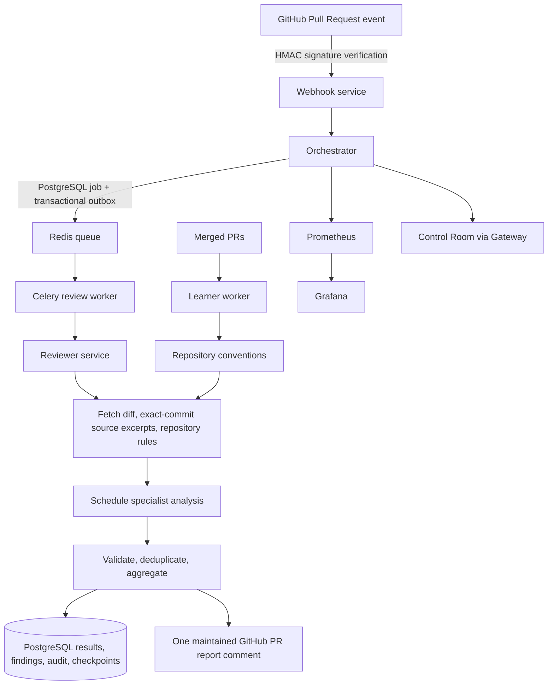

# Fidelis

<p align="center">
  <strong>Multi-agent AI code review for GitHub pull requests.</strong><br>
  Bring your own model. Keep the review pipeline.
</p>

<p align="center">
  
  
  
  
</p>

Fidelis turns a GitHub pull request into a structured, auditable code review. It receives signed GitHub events, builds a bounded review context, runs specialist analysis, validates and consolidates findings, stores the result, and publishes one maintained report comment on the pull request.

It can run against a **local model** or a **hosted API**. The model is replaceable; the review workflow stays the same.

> **Status:** Working end-to-end baseline demonstrated with local DeepSeek through llama.cpp and Gemini through Google's OpenAI-compatible API. Reviews are advisory: Fidelis does not approve, merge, or modify code.

---

## Why Fidelis?

A useful code-review system needs more than a prompt sent to an LLM. It needs reliable event handling, context retrieval, execution control, validation, persistence, delivery, and observability.

Fidelis brings those pieces together:

- **Four specialist perspectives** — Static Analysis, Security, Architecture, and Code Style.
- **Pluggable inference** — use a local OpenAI-compatible endpoint or a hosted API such as Gemini.
- **Flexible scheduling** — sequential, single-pass, or parallel execution.
- **Checkpointed reviews** — persist completed specialist passes and reuse them when a retry has the same review context.
- **Repository-aware context** — combine the PR diff with bounded source excerpts from the exact commit and learned repository conventions.
- **Validated findings** — check structure and changed-line anchors, apply high-signal deterministic checks, then aggregate and deduplicate results.
- **GitHub-native delivery** — create or update one consolidated PR comment instead of flooding the discussion with separate reports.
- **Operational visibility** — inspect jobs, specialist timings, token usage, lifecycle events, delivery status, and metrics.

## How it works



### The four specialists

| Specialist | Focus |
|---|---|
| `STATIC_ANALYSIS` | High-signal correctness and security patterns, unsafe operations, and suspicious changed code. |
| `SECURITY` | Injection, authorization, trust boundaries, unsafe input-to-sink flows, and security regressions. |
| `ARCHITECTURE` | Component boundaries, coupling, API contracts, data flow, and design risks. |
| `CODE_STYLE` | Maintainability, consistency, duplication, naming, and clarity. |

Specialists are independently selectable. The scheduler is configured separately, so the same agents can run in different execution modes.

### Execution strategies

| Strategy | How it works | Best fit |
|---|---|---|
| `sequential` | One specialist request at a time. Completed passes are checkpointed. | Local inference and constrained hardware. |
| `single_pass` | One model request handles all selected perspectives and returns separate specialist results. | Hosted APIs when reducing repeated context submission matters. |
| `parallel` | Specialists run concurrently. | High-capacity inference endpoints. |

The sequential profile is the primary demonstrated workflow: one loaded model performs four separate passes. It does not require four model instances.

## Model backends

Fidelis uses an OpenAI-compatible Chat Completions interface. Changing providers is primarily an environment-configuration change; the webhook, orchestrator, specialist definitions, persistence, and GitHub publisher remain the same.

### Local inference — llama.cpp

Example `.env` settings:

```dotenv
REVIEWER_MODE=llm
REVIEW_AGENTS=STATIC_ANALYSIS,SECURITY,ARCHITECTURE,CODE_STYLE
REVIEW_EXECUTION_STRATEGY=sequential
REVIEW_CHECKPOINTS_ENABLED=true

LLM_BASE_URL=http://host.docker.internal:8080/v1
LLM_API_KEY=your-local-server-key
LLM_MODEL=fidelis-deepseek14b
LLM_TIMEOUT_SECONDS=300
LLM_MAX_TOKENS=4096
```

Start `llama-server` on the host before sending a review. It must be reachable from Docker and expose `/v1/chat/completions`. If the server enforces an API key, `LLM_API_KEY` must match it. Set `LLM_MODEL` to the exact model alias served by llama.cpp.

### Hosted inference — Gemini

Example `.env` settings:

```dotenv
REVIEWER_MODE=llm
REVIEW_AGENTS=STATIC_ANALYSIS,SECURITY,ARCHITECTURE,CODE_STYLE
REVIEW_EXECUTION_STRATEGY=sequential
REVIEW_CHECKPOINTS_ENABLED=true

LLM_BASE_URL=https://generativelanguage.googleapis.com/v1beta/openai
LLM_API_KEY=your-gemini-api-key
LLM_MODEL=gemini-3.5-flash-lite
LLM_REASONING_EFFORT=minimal
LLM_TIMEOUT_SECONDS=120
LLM_MAX_TOKENS=4096
```

Create an API key in [Google AI Studio](https://aistudio.google.com/apikey). Gemini API access and a consumer Google AI subscription are separate products; API quotas and billing are governed by the Gemini Developer API plan. Check current model availability, quotas, pricing, and data-use terms before sending code.

For other OpenAI-compatible providers, set `LLM_BASE_URL`, `LLM_API_KEY`, and `LLM_MODEL` to the provider's documented values. Provider-specific reasoning settings should only be set when that provider supports them.

> **Privacy:** A hosted model receives the code context sent by Fidelis. Do not submit proprietary, confidential, or otherwise restricted source code to an external provider unless you are authorised to do so. Review provider retention and data-use terms first.

## Quick start

### Requirements

- Docker Desktop or Docker Engine with Docker Compose v2.
- Python 3.12+ for local scripts and tests.
- A GitHub repository and a token or GitHub App installation with the required repository permissions.
- A reachable local model endpoint or hosted LLM API key for real reviews.

### 1. Configure the environment

```bash
cp .env.example .env
```

On Windows, copy `.env.example` to `.env` using Explorer or PowerShell. Edit `.env` and replace development placeholders and secrets. Never commit `.env`.

### 2. Start the stack

```bash
docker compose up --build -d --wait
docker compose ps
```

On Windows PowerShell, the repository also includes a helper:

```powershell
.\scripts\dev-up.ps1
```

### 3. Open the interfaces

| Interface | Local URL | Purpose |
|---|---|---|
| Control Room | http://localhost:8000 | Review history, jobs, findings, agent runs, and delivery status. |
| Grafana | http://localhost:3000 | Provisioned operational dashboard. Change the sample local credentials. |
| Prometheus | http://localhost:9090 | Metrics and service telemetry. |
| Reviewer API docs | http://localhost:8003/docs | Reviewer service API. |
| Orchestrator API docs | http://localhost:8001/docs | Job and result API. |

### 4. Run the smoke test

```bash
python scripts/smoke_test.py
```

In LLM mode, this smoke test checks service health, authentication, and reviewer configuration. It deliberately skips synthetic PR jobs and synthetic GitHub webhook events because those fixtures do not represent a real accessible GitHub pull request. It does not spend model tokens.

For a Gemini connectivity and JSON-compatibility check, run:

```bash
docker compose exec reviewer python -m app.gemini_smoke_test
```

This makes one small Gemini API request and does not create or modify a GitHub PR.

## Connect GitHub

1. Start the Fidelis stack and expose the **Gateway** (host port `8000`) through a public HTTPS URL. A tunnel is suitable for local demonstrations.
2. In the GitHub repository, add a webhook with payload URL `https://<public-host>/webhook/github`, content type `application/json`, and the same secret as `GITHUB_WEBHOOK_SECRET` in `.env`.
3. Subscribe to `pull_request` events. Fidelis handles `opened`, `synchronize`, and `reopened` actions.
4. Configure `GITHUB_TOKEN` with access to the target repository:
   - **Pull requests: Read** and **Contents: Read** for PR diff and source retrieval.
   - **Issues: Read and write** or **Pull requests: Read and write** to publish the consolidated PR comment.
5. Set `PUBLISH_GITHUB_REVIEWS=true` to enable report delivery.

A non-empty GitHub token does not imply write permission. The publisher creates or updates one marked issue comment per PR. If GitHub rejects delivery, the structured review remains persisted and the delivery failure is recorded in the audit trail.

For local testing, ensure the tunnel forwards to `localhost:8000`, not directly to the Webhook container port. The Gateway exposes `/webhook/github` and forwards the event to the Webhook service.

## Context, validation, and repository learning

### Review context

For a real GitHub PR, Fidelis retrieves:

- The pull-request diff.
- Bounded source excerpts for changed files at the exact commit being reviewed.
- Repository conventions learned from previously merged pull requests.

Fidelis does not clone or submit the entire repository. Context is bounded by `MAX_DIFF_CHARS`, `MAX_SOURCE_CONTEXT_CHARS`, `MAX_CONTEXT_FILES`, and `SOURCE_CONTEXT_LINES`. The patch remains authoritative.

### Finding validation

Model output is treated as untrusted input. Fidelis validates the result structure and changed-line anchors, counts rejected candidates, performs deterministic high-signal checks, and aggregates specialist results. Duplicate reports may still describe the same underlying issue; review findings require human verification.

The deterministic checks are a focused complement, **not a complete static-analysis or security-scanning engine**. They can miss vulnerabilities and can produce false positives.

### Repository learning

The Learner processes merged PRs and extracts inspectable repository conventions such as common source directories, file extensions, test-file patterns, naming style, and type-hint patterns. These rules become additional reviewer context. This is convention mining, not model fine-tuning or self-modifying model training.

## Control Room, APIs, and observability

The Control Room is served by the Gateway. It provides an operational view of review jobs, results, findings, agent execution, token usage, and GitHub delivery status.

The Orchestrator is the system of record. It stores jobs, structured results, findings, specialist telemetry, checkpoints, and lifecycle/delivery audit events in PostgreSQL. Redis is used as the Celery broker and result backend.

Useful Orchestrator endpoints (internal port `8001`; Gateway routes are authenticated and prefixed with `/api/orchestrator/`):

| Endpoint | Purpose |
|---|---|
| `POST /jobs` | Idempotently create a job for a repository, PR, and commit SHA. |
| `GET /jobs` and `GET /jobs/{id}` | List and inspect jobs. |
| `GET /jobs/{id}/result` | Retrieve the structured review result. |
| `GET /jobs/{id}/events` | Inspect lifecycle and delivery audit events. |
| `POST /jobs/{id}/replay` | Create a new review attempt while preserving history. |
| `GET /repositories/{owner/repo}/rules` | Retrieve learned repository conventions. |
| `GET /metrics/summary` | Dashboard metrics, agent runtime, and token totals. |
| `GET /metrics` | Prometheus metrics. |

Prometheus scrapes Orchestrator metrics. Grafana is provisioned with a Fidelis overview dashboard. Optional Langfuse v4 tracing can record agent-generation metadata and token counts; source diffs and code-bearing prompts are deliberately excluded by the integration.

## Testing and evaluation

Install development dependencies:

```bash
pip install -r requirements-dev.txt
```

Run tests from each service directory:

```bash
cd services/orchestrator
DATABASE_URL=sqlite:///./test.db python -m pytest -q

cd ../reviewer
python -m pytest -q

cd ../gateway
python -m pytest -q

cd ../webhook
python -m pytest -q

cd ../learner
python -m pytest -q
```

Run live-stack integration tests with Docker available:

```bash
docker compose up -d --build --wait
python -m pytest tests/integration -v
```

Compare sequential, single-pass, and parallel strategies against labelled fixtures:

```bash
python scripts/evaluate_pipelines.py --repeat 2
```

The evaluation harness records expected and predicted categories, misses, false positives, precision, recall, F1, latency, model tokens, and agent timing. The fixtures are simplified, human-labelled examples—not a validated scientific benchmark. Inspect findings manually before using evaluation numbers in a report.

A concurrent load test is also available:

```bash
python scripts/load_test.py --requests 10 --concurrency 2
```

Load tests can consume API quota or incur model charges when LLM mode is enabled. Start with low request counts.

## Configuration reference

Important environment variables:

| Variable | Purpose |
|---|---|
| `REVIEWER_MODE` | `mock` or `llm`. |
| `REVIEW_AGENTS` | Comma-separated specialist selection. |
| `REVIEW_EXECUTION_STRATEGY` | `sequential`, `single_pass`, or `parallel`. |
| `REVIEW_CHECKPOINTS_ENABLED` | Persist completed specialist passes. |
| `LLM_BASE_URL` | OpenAI-compatible API base URL. |
| `LLM_API_KEY` | Provider or local-server API key. |
| `LLM_MODEL` | Exact model identifier/alias. |
| `LLM_TIMEOUT_SECONDS` | Model request timeout. |
| `LLM_MAX_TOKENS` | Model output-token budget. |
| `GITHUB_WEBHOOK_SECRET` | HMAC secret used to verify GitHub webhook signatures. |
| `GITHUB_TOKEN` | GitHub access for diff/source retrieval and comment publishing. |
| `PUBLISH_GITHUB_REVIEWS` | Enable or disable GitHub report comments. |
| `MAX_DIFF_CHARS` | Maximum diff context size. |
| `MAX_SOURCE_CONTEXT_CHARS` | Maximum retrieved source context. |
| `MAX_CONTEXT_FILES` | Maximum changed files with retrieved source excerpts. |
| `SOURCE_CONTEXT_LINES` | Surrounding source lines to retrieve. |

See `.env.example` and `GEMINI-API-SETUP.md` for the configuration shipped with this repository.

## Security and known limitations

- Replace all development secrets: `JWT_SECRET`, `GITHUB_WEBHOOK_SECRET`, `WORKER_STATUS_TOKEN`, database credentials, and Grafana credentials. Never commit `.env` or paste API tokens into issues, logs, screenshots, or source files.
- The supplied Compose stack is intended for local development. It publishes several service and database ports to the host. Do not expose Postgres, Redis, Orchestrator, Reviewer, or Learner directly to the public internet.
- Use a narrowly scoped GitHub App installation token or fine-grained personal access token. Grant only the repository permissions needed for review and comment delivery.
- External LLM providers receive the source context Fidelis sends. Obtain approval before sending private or regulated code to a hosted provider.
- Findings are advisory and may be incorrect, duplicated, incomplete, or missed. A developer must verify every finding. Fidelis does not change code or approve pull requests.
- Repository learning is heuristic and inspectable; it does not guarantee that learned conventions are correct.
- GitHub comment delivery is best-effort. Review results remain stored even if comment publication fails.
- The project does not yet include a formal database migration framework. Introduce and test migrations before applying schema changes to databases containing valuable data.
- Live external integrations depend on real credentials, provider availability, quotas, network access, and a working Docker host. Passing unit tests alone does not certify a live deployment.

## Documentation

- [Architecture and service ownership](docs/architecture.md)
- [Roadmap completion matrix](docs/completion-matrix.md)
- [Operations and troubleshooting](docs/runbooks/operations.md)
- [GitHub delivery troubleshooting](docs/runbooks/github-delivery.md)
- [Evaluation protocol](docs/evaluation.md)
- [Security model](docs/security.md)
- [Reviewer contract](docs/contracts/reviewer-contract.md)
- [Review-worker contract](docs/contracts/review-worker-interface.md)
- [Webhook event contract](docs/contracts/webhook-events.md)

---

<p align="center">
  <strong>Fidelis</strong><br>
  <sub>One pull request. Multiple perspectives. One actionable review.</sub>
</p>
